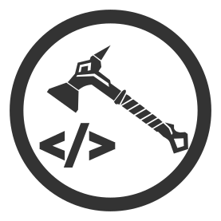

# Hefesto - Libreria simple para aplicaciones web basadas en Echo con Go



## Ejemplo de uso

```go
package main

import (
	"fmt"
	"log"
	"os"

	"github.com/wfrs-dev/hefesto/app/config"
	"github.com/wfrs-dev/hefesto/app/infra/server"
)

var Version = "0.0.0-dev"

func main() {
	if len(os.Args) < 2 {
		fmt.Println("No se ha especificado el archivo de configuración json")
		os.Exit(1)
	}

	if os.Args[1] == "gen-config" {
		err := config.GenerateDefaultConfig()
		if err != nil {
			log.Fatal(err)
		}
		fmt.Println("Se ha generado el archivo de configuración `config/config.json`")
		os.Exit(0)
	}

	fmt.Println("Cargando configuración desde", os.Args[1])
	cfg, err := config.Load(os.Args[1])
	if err != nil {
		log.Fatal(err)
	}

	srv, err := server.New(cfg)
	if err != nil {
		log.Fatal(err)
	}

	registerModules(srv)

	if err := srv.Start(); err != nil {
		log.Fatal(err)
	}
}

func registerModules(srv *server.Server) {
	srv.AddModule(handler.New( /* ... */ ))
	// ...
}
```
